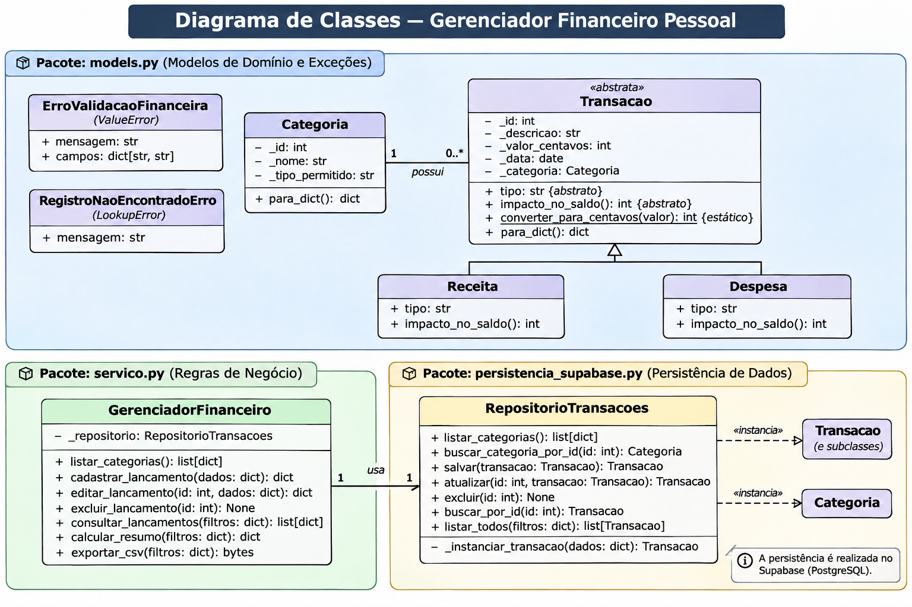

# Gerenciador Financeiro Pessoal

Aplicação web desenvolvida como projeto acadêmico das disciplinas de **Programação Orientada a Objetos (POO)** e **JavaScript**, com o objetivo de facilitar o controle de receitas, despesas e saldos financeiros.

O sistema utiliza **Python, Flask, HTML, CSS, JavaScript e Supabase (PostgreSQL)**, integrando uma interface web responsiva com uma API REST e persistência de dados.

## Funcionalidades

### Gerenciamento financeiro

- Cadastro de receitas e despesas.
- Edição e exclusão de lançamentos.
- Classificação por categorias.
- Consulta de movimentações financeiras.
- Armazenamento permanente no Supabase.
- Validação dos dados inseridos.

### Painel de controle

- Total de receitas do período.
- Total de despesas do período.
- Resultado financeiro (receitas menos despesas).
- Saldo acumulado.
- Distribuição das despesas por categoria.
- Seleção do mês para análise financeira.

### Pesquisa e filtros

- Pesquisa por descrição.
- Filtro por mês.
- Filtro por tipo de lançamento.
- Filtro por categoria.
- Opção de limpar filtros.
- Exportação de lançamentos em CSV.

### Interface

- Design responsivo.
- Formulário interativo de cadastro e edição.
- Mensagens de sucesso e erro.
- Confirmação antes da exclusão.
- Atualização dinâmica das informações.

## Tecnologias utilizadas

| Tecnologia | Utilização |
|---|---|
| Python | Programação Orientada a Objetos |
| Flask | Backend e API REST |
| HTML5 | Estrutura da interface |
| CSS3 | Estilização e responsividade |
| JavaScript | Interatividade, DOM e requisições HTTP |
| Supabase | Persistência de dados |
| PostgreSQL | Banco de dados relacional |
| Git e GitHub | Versionamento e documentação |
| Pytest | Execução de testes automatizados |

## Arquitetura do sistema

O projeto foi dividido em camadas para facilitar a manutenção e a compreensão do código.

**Frontend:** apresenta a interface e realiza requisições HTTP por meio de `fetch()`.

**API Flask:** recebe as requisições, chama os serviços e devolve respostas JSON.

**Serviço:** aplica as regras de negócio, valida dados, realiza cálculos e coordena operações.

**Modelos:** representam as entidades financeiras por meio de classes Python.

**Persistência:** realiza consultas, inserções, atualizações e exclusões no Supabase.

Fluxo de funcionamento:

1. O usuário interage com a interface.
2. O JavaScript envia uma requisição ao Flask.
3. O Flask aciona a classe `GerenciadorFinanceiro`.
4. O serviço utiliza as classes de domínio e o repositório.
5. O repositório comunica-se com o Supabase.
6. O resultado retorna para a interface.

## Programação Orientada a Objetos

### Abstração

A classe `Transacao` é abstrata e define os atributos e comportamentos compartilhados pelas movimentações financeiras.

### Herança

As classes `Receita` e `Despesa` herdam da classe `Transacao`.

### Polimorfismo

O método `impacto_no_saldo()` possui implementações diferentes:

- Receita: impacto positivo.
- Despesa: impacto negativo.

### Encapsulamento

Os atributos são protegidos por propriedades e validações, evitando alterações que deixem os objetos inconsistentes.

### Associação

Cada transação está vinculada a uma categoria. Uma categoria pode estar associada a várias transações.

### Separação de responsabilidades

Os módulos `models.py`, `servico.py`, `persistencia_supabase.py` e `app.py` possuem responsabilidades distintas.

## Estrutura do projeto

- `app.py` — Rotas e API Flask.
- `models.py` — Classes de domínio.
- `servico.py` — Regras de negócio.
- `persistencia_supabase.py` — Comunicação com o Supabase.
- `tests_models.py` — Testes automatizados.
- `requirements.txt` — Dependências Python.
- `.env.example` — Modelo de configuração.
- `.gitignore` — Proteção de arquivos locais.
- `templates/index.html` — Interface HTML.
- `static/css/styles.css` — Estilização.
- `static/js/app.js` — Interatividade e requisições à API.
- `docs/estrutura_supabase.sql` — Banco de dados.
- `docs/diagrama_classes.puml` — Diagrama editável.
- `docs/diagrama_classes.png` — Imagem do diagrama.

## Como executar o projeto

### 1. Pré-requisitos

- Python 3.10 ou superior.
- Git ou uma cópia dos arquivos do repositório.
- VS Code ou outro editor de código.
- Conta no Supabase.
- Navegador atualizado.

### 2. Obter os arquivos

Clone o repositório ou utilize a opção **Code → Download ZIP** no GitHub.

Abra a pasta principal do projeto no VS Code.

### 3. Instalar dependências

No terminal do VS Code, em Windows, execute:

`py -m venv .venv`

Depois:

`.\.venv\Scripts\python.exe -m pip install -r requirements.txt`

Em Linux ou macOS:

`python3 -m venv .venv`

` .venv/bin/python -m pip install -r requirements.txt`

### 4. Configurar o Supabase

1. Acesse o painel do Supabase.
2. Crie um projeto.
3. Abra o SQL Editor.
4. Execute o script `docs/estrutura_supabase.sql`, após revisar as configurações de acesso.
5. Confirme a criação das tabelas `categorias` e `lancamentos`.

### 5. Configurar o arquivo .env

Crie um arquivo `.env` na raiz do projeto com as seguintes variáveis:

`SUPABASE_URL=https://SEU-PROJETO.supabase.co`

`SUPABASE_KEY=SUA_CHAVE_PRIVADA_DO_BACKEND`

`FLASK_DEBUG=0`

Substitua os valores fictícios pelas informações do seu projeto.

**Nunca publique a chave secreta no GitHub ou no frontend.**

### 6. Executar o Flask

No Windows:

`.\.venv\Scripts\python.exe app.py`

Em Linux ou macOS:

`.venv/bin/python app.py`

Abra no navegador:

**http://127.0.0.1:5000**

Não abra o `index.html` diretamente, pois a página depende do Flask e da API.

## Como utilizar

1. Clique em **Novo lançamento**.
2. Selecione Receita ou Despesa.
3. Informe descrição, valor, data e categoria.
4. Clique em **Salvar lançamento**.
5. Consulte a movimentação na tabela.
6. Utilize os botões de edição ou exclusão quando necessário.
7. Experimente os filtros e confira o resumo financeiro.
8. Clique em **Exportar CSV** para obter os dados filtrados.

Os valores são armazenados no banco em centavos, evitando imprecisões em cálculos monetários. Uma coluna calculada `valor_reais` pode facilitar a visualização no Supabase.

## API REST

| Método | Endpoint | Função |
|---|---|---|
| GET | `/api/categorias` | Consultar categorias |
| GET | `/api/lancamentos` | Consultar lançamentos |
| POST | `/api/lancamentos` | Cadastrar lançamento |
| PUT | `/api/lancamentos/{id}` | Editar lançamento |
| DELETE | `/api/lancamentos/{id}` | Excluir lançamento |
| GET | `/api/resumo` | Consultar resumo financeiro |
| GET | `/api/exportar` | Exportar CSV |

A API utiliza JSON para as operações de consulta e cadastro, incluindo tratamento de erros de validação, registros inexistentes e falhas internas.

## Testes automatizados

O arquivo `tests_models.py` contém seis testes das classes de domínio.

Para executar no Windows:

`.\.venv\Scripts\python.exe -m pytest -q tests_models.py`

Os testes verificam:

- Criação de receitas e despesas.
- Abstração da classe Transacao.
- Rejeição de dados inválidos.
- Encapsulamento.
- Polimorfismo.
- Conversão de objetos em dicionários.

Os testes das classes não substituem a verificação da integração com o banco.

## Roteiro de testes manuais

- [ ] Cadastrar uma receita.
- [ ] Cadastrar uma despesa.
- [ ] Editar um lançamento.
- [ ] Excluir um lançamento.
- [ ] Filtrar por mês.
- [ ] Filtrar por tipo e categoria.
- [ ] Pesquisar uma descrição.
- [ ] Verificar o cálculo do saldo.
- [ ] Exportar o CSV.
- [ ] Atualizar a página e confirmar a persistência.
- [ ] Testar campos inválidos.
- [ ] Verificar a interface em telas menores.

## Diagrama de classes UML

O diagrama apresenta as classes principais, seus atributos, métodos e relacionamentos.

[Código PlantUML editável](docs/diagrama_classes.puml)

## Banco de dados

O banco de dados utiliza as tabelas `categorias` e `lancamentos`, relacionadas pela chave estrangeira `categoria_id`.

O script de criação está disponível em:

[estrutura_supabase.sql](docs/estrutura_supabase.sql)

## Segurança e limitações

O sistema foi desenvolvido para fins acadêmicos e demonstração local.

A versão atual não possui autenticação individual nem isolamento de dados por usuário. Para utilização pública com dados financeiros reais, seriam necessárias autenticação, autorização e políticas adequadas de acesso ao banco.

As chaves privilegiadas do Supabase devem permanecer exclusivamente no servidor.

## Integrantes

| Integrante | Contribuição |
|---|---|
| [Nome do integrante 1] | [Contribuição real] |
| [Nome do integrante 2] | [Contribuição real] |
| [Nome do integrante 3] | [Contribuição real] |

**Instituição:** [Faculdade Anhanguera Uberlândia]

**Disciplinas:** Programação Orientada a Objetos e JavaScript

**Período:** [6° Período]

## Objetivo acadêmico

O projeto demonstra a aplicação integrada de conceitos de Programação Orientada a Objetos, desenvolvimento web, manipulação do DOM, validação de dados, comunicação assíncrona, APIs REST, banco de dados relacional e versionamento de código.
